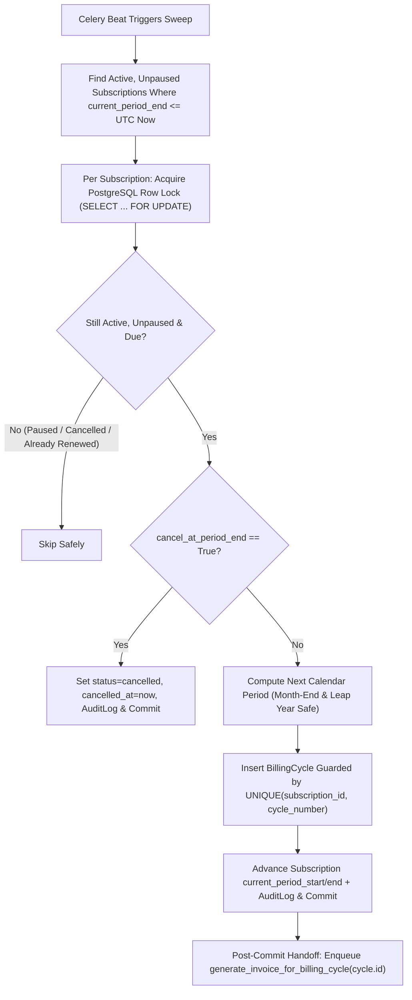

# Billing Cycle Scheduler & Celery Architecture

**Project:** Subscription Billing Automation System Using Recurring Revenue Model (Infosys Springboard)  
**Module:** Automated Billing Cycle Scheduler & Celery Task Infrastructure

---

## 1. Celery Architecture

The asynchronous billing subsystem decouples periodic billing sweeps from the FastAPI web tier using **Celery 5.x** backed by **Redis**:

```text
+-----------------------+       +-------------------------+
|     Celery Beat       |       |      Redis Broker       |
|  Periodic Scheduler   | ----> |  Queues:                |
| (BILLING_SCHEDULER_   |       |   - billing             |
|  INTERVAL_SECONDS)    |       |   - invoicing           |
+-----------------------+       +------------+------------+
                                             |
                        +--------------------+--------------------+
                        |                                         |
                        v                                         v
        +-------------------------------+         +-------------------------------+
        |     Celery Worker (billing)   |         |   Celery Worker (invoicing)   |
        | process_due_subscriptions_task| ------> | generate_invoice_for_         |
        |  - PostgreSQL Row Locks       |  delay  |   billing_cycle               |
        |  - BillingCycle Creation      |         | (Phase 4 Invoice Handoff)     |
        +---------------+---------------+         +-------------------------------+
                        |
                        v
        +-------------------------------+
        |        PostgreSQL 18          |
        | - subscriptions (FOR UPDATE)  |
        | - billing_cycles (UNIQUE key) |
        | - audit_logs (immutable)      |
        +-------------------------------+
```

### Key Reliability Settings ([`backend/app/core/celery_app.py`](../backend/app/core/celery_app.py))
- **`task_acks_late = True` & `task_reject_on_worker_lost = True`:** Tasks are acknowledged only after successful completion, ensuring crashed worker tasks are re-queued automatically.
- **`worker_prefetch_multiplier = 1`:** Prevents greedy task pre-fetching across concurrent workers.
- **Timezone:** `UTC` (`enable_utc = True`).
- **Serialization:** Pure JSON (`task_serializer = "json"`).

---

## 2. Redis Configuration

Redis acts as both the **Message Broker** (`REDIS_DB=0`) and **Result Backend** (`REDIS_RESULT_DB=1`). All settings are loaded via [`Settings`](../backend/app/core/config.py) from environment variables:

```env
REDIS_HOST="localhost"
REDIS_PORT=6379
REDIS_DB=0
REDIS_RESULT_DB=1
# REDIS_PASSWORD=""
# CELERY_BROKER_URL="redis://localhost:6379/0"
# CELERY_RESULT_BACKEND="redis://localhost:6379/1"
CELERY_TIMEZONE="UTC"
CELERY_TASK_ALWAYS_EAGER=false
BILLING_SCHEDULER_INTERVAL_SECONDS=3600
CELERY_TASK_MAX_RETRIES=3
CELERY_TASK_RETRY_DELAY_SECONDS=60
```

### Starting Redis via Docker Compose
```powershell
cd subscription-billing-system
docker compose up -d redis
```

---

## 3. Worker & Beat Startup Commands

Navigate to `subscription-billing-system/backend` with your virtual environment activated:

### Start Celery Worker
```powershell
# Windows (recommended --pool=solo for development)
python -m celery -A app.core.celery_app:celery_app worker --loglevel=info -Q billing,invoicing,default --pool=solo

# Linux / macOS (multi-process concurrency)
python -m celery -A app.core.celery_app:celery_app worker --loglevel=info -Q billing,invoicing,default --concurrency=4
```

### Start Celery Beat (Periodic Scheduler)
```powershell
python -m celery -A app.core.celery_app:celery_app beat --loglevel=info
```

*Beat Schedule Key:* `"process-due-billing-cycles"` executes `app.tasks.billing_tasks.process_due_subscriptions_task` every `BILLING_SCHEDULER_INTERVAL_SECONDS` (default: `3600` seconds).

---

## 4. Billing Cycle Workflow & Idempotency



### Concurrency & Duplicate Prevention
1. **Row-Level Locking:** Each due subscription is processed in its own isolated PostgreSQL transaction with `SELECT ... FOR UPDATE`. Concurrent workers block and then re-verify `current_period_end <= now`; once the first worker advances the period, subsequent workers cleanly skip.
2. **Database Uniqueness:** `uq_billing_cycles_subscription_cycle` on `(subscription_id, cycle_number)` guarantees at most one `BillingCycle` per cycle index even across crashes or task retries.
3. **Calendar-Accurate Renewal Dates ([`billing_dates.py`](../backend/app/services/billing_dates.py)):** Advances exact calendar months/years in UTC (`Jan 31 -> Feb 28/29 -> Mar 31`, `Feb 29, 2024 -> Feb 28, 2025`), eliminating 30-day drift.

---

## 5. Invoice Generation Handoff Interface

When a `BillingCycle` commits with status `PENDING`, `BillingCycleService` enqueues the handoff task defined in [`app/tasks/invoice_tasks.py`](../backend/app/tasks/invoice_tasks.py):

- **Task Name:** `app.tasks.invoice_tasks.generate_invoice_for_billing_cycle`
- **Queue:** `invoicing`
- **Input Argument:** `billing_cycle_id: int`
- **Current Scope:** Validates the `BillingCycle` record and returns the handoff envelope (`status="queued_for_invoice_engine"`, `subscription_id`, `cycle_number`, `amount`, `currency`).
- **Phase 4 Connection:** In Phase 4, the full Invoice Engine (`InvoiceService`) will plug directly into this task to compute line items/taxes, generate `Invoice` rows, render ReportLab PDFs, and trigger payment processing—without modifying the Billing Cycle Scheduler.

