# Entity-Relationship (ER) Diagram

**Project:** Subscription Billing Automation System Using Recurring Revenue Model (Infosys Springboard)  
**Database Engine:** PostgreSQL 18  
**Migration Revision:** `47fd1264f12c` (`add_payment_refunds_and_webhook_events`)

---

## Visual ER Diagram

```mermaid
erDiagram
    PLANS {
        integer id PK
        varchar name
        varchar code UK "Unique plan identifier"
        text description
        numeric price "Non-negative decimal(12,2)"
        varchar currency "3-letter uppercase ISO"
        enum billing_interval "monthly | quarterly | yearly"
        integer trial_days
        jsonb features
        boolean is_active
        timestamptz deleted_at "Soft deletion timestamp"
        timestamptz created_at
        timestamptz updated_at
    }

    CUSTOMERS {
        integer id PK
        varchar customer_code UK
        varchar full_name
        varchar email UK
        varchar phone
        varchar company_name
        text billing_address
        varchar tax_id
        varchar currency "3-letter uppercase ISO"
        boolean is_active
        timestamptz deleted_at "Soft deletion timestamp"
        timestamptz created_at
        timestamptz updated_at
    }

    SUBSCRIPTIONS {
        integer id PK
        varchar subscription_code UK
        integer customer_id FK "ON DELETE RESTRICT"
        integer plan_id FK "ON DELETE RESTRICT"
        enum status "trial | active | past_due | cancelled"
        integer quantity
        numeric unit_price "Historical price snapshot"
        varchar currency "Contracted currency snapshot"
        enum billing_interval "Contracted interval snapshot"
        timestamptz start_date
        timestamptz current_period_start
        timestamptz current_period_end
        timestamptz trial_start
        timestamptz trial_end
        boolean cancel_at_period_end
        timestamptz cancelled_at
        boolean is_paused "Orthogonal pause flag"
        timestamptz paused_at
        timestamptz resumed_at
        integer paused_remaining_seconds "Check >= 0"
        varchar pause_reason
        timestamptz created_at
        timestamptz updated_at
    }

    BILLING_CYCLES {
        integer id PK
        integer subscription_id FK "ON DELETE RESTRICT"
        integer cycle_number "Unique with subscription_id"
        timestamptz period_start
        timestamptz period_end
        timestamptz billing_date
        enum status "pending | processing | completed | failed"
        numeric amount
        varchar currency
        timestamptz processed_at
        text failure_reason
        timestamptz created_at
        timestamptz updated_at
    }

    INVOICES {
        integer id PK
        varchar invoice_number UK
        integer customer_id FK "ON DELETE RESTRICT"
        integer subscription_id FK "ON DELETE SET NULL"
        integer billing_cycle_id FK,UK "ON DELETE RESTRICT"
        numeric subtotal
        numeric tax_amount
        numeric discount_amount
        numeric total_amount
        numeric amount_paid
        varchar currency
        enum status "draft | open | paid | void | uncollectible"
        timestamptz issue_date
        timestamptz due_date
        timestamptz paid_at
        varchar pdf_path
        text notes
        timestamptz created_at
        timestamptz updated_at
    }

    INVOICE_ITEMS {
        integer id PK
        integer invoice_id FK "ON DELETE CASCADE"
        enum item_type "base_subscription | plan_upgrade | proration_credit | proration_debit | usage | tax"
        varchar description
        integer quantity
        numeric unit_price
        numeric amount
        timestamptz created_at
    }

    PAYMENTS {
        integer id PK
        varchar transaction_reference UK
        varchar idempotency_key UK "Nullable request idempotency key"
        integer invoice_id FK "ON DELETE RESTRICT"
        integer customer_id FK "ON DELETE RESTRICT"
        numeric amount
        numeric refunded_amount "Check 0 <= refunded_amount <= amount"
        varchar currency
        enum payment_method "credit_card | debit_card | bank_transfer | upi | simulated"
        enum status "pending | succeeded | failed | refunded"
        timestamptz payment_date
        text failure_reason
        jsonb gateway_response
        timestamptz created_at
        timestamptz updated_at
    }

    PAYMENT_REFUNDS {
        integer id PK
        varchar refund_reference UK
        varchar idempotency_key UK "Nullable"
        integer payment_id FK "ON DELETE RESTRICT"
        integer invoice_id FK "ON DELETE RESTRICT"
        integer customer_id FK "ON DELETE RESTRICT"
        numeric amount "Check > 0"
        varchar currency
        enum status "pending | succeeded | failed"
        text reason
        jsonb gateway_response
        timestamptz refunded_at
        timestamptz created_at
        timestamptz updated_at
    }

    WEBHOOK_EVENTS {
        integer id PK
        varchar event_id UK
        varchar gateway
        varchar event_type
        integer payment_id FK "ON DELETE RESTRICT (nullable)"
        varchar transaction_reference
        boolean signature_verified
        varchar processing_status "received | processed | ignored_stale | rejected"
        jsonb payload
        text error_message
        timestamptz received_at
        timestamptz processed_at
    }

    AUDIT_LOGS {
        integer id PK
        varchar entity_type
        integer entity_id
        varchar action
        varchar actor
        integer customer_id FK "ON DELETE RESTRICT (nullable)"
        jsonb old_values
        jsonb new_values
        varchar ip_address
        text description
        timestamptz created_at
    }

    PLANS ||--o{ SUBSCRIPTIONS : "defines tier for"
    CUSTOMERS ||--o{ SUBSCRIPTIONS : "holds"
    SUBSCRIPTIONS ||--o{ BILLING_CYCLES : "schedules"
    BILLING_CYCLES ||--o| INVOICES : "produces"
    CUSTOMERS ||--o{ INVOICES : "billed via"
    SUBSCRIPTIONS ||--o{ INVOICES : "generates"
    INVOICES ||--|{ INVOICE_ITEMS : "itemizes"
    INVOICES ||--o{ PAYMENTS : "settled by"
    INVOICES ||--o{ PAYMENT_REFUNDS : "tracks refunds for"
    PAYMENTS ||--o{ PAYMENT_REFUNDS : "refunded via"
    PAYMENTS ||--o{ WEBHOOK_EVENTS : "receives events for"
    CUSTOMERS ||--o{ PAYMENTS : "executes"
    CUSTOMERS ||--o{ PAYMENT_REFUNDS : "receives"
    CUSTOMERS ||--o{ AUDIT_LOGS : "associated with"
```

